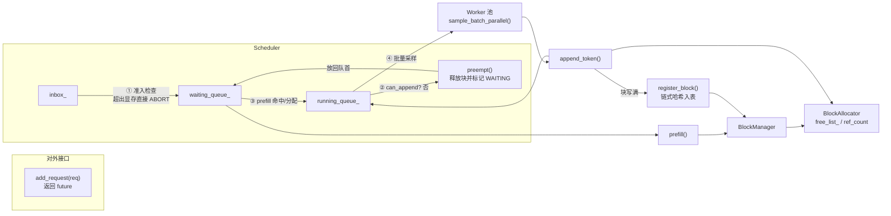
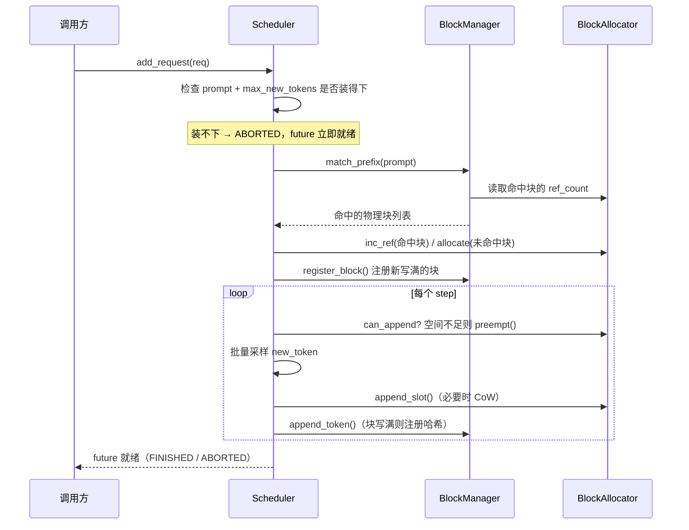

# KV_Cache — 用 C++17 复现 vLLM 的分页 KV Cache 与调度器

> 学习项目：从零用 C++17 实现 vLLM 的核心机制 —— **分页 KV Cache、块级引用计数与写时复制、链式前缀哈希复用、连续批处理与抢占调度**。
> 不包含 GPU kernel 与真实模型推理，专注内存管理与调度逻辑的可读实现与可测试性。


## 这是什么

`vLLM` 的 PagedAttention 把 KV Cache 切成固定大小的物理块，用 `block_table` 做逻辑块到物理块的映射，从而解决显存碎片与前缀复用问题。本项目把这套机制的**数据结构与调度策略**用纯 C++ 重新实现了一遍，KV 内容用整数模拟，不依赖任何第三方库。

适合用来：理解 vLLM 的内存管理思路、学习 `shared_ptr` + 引用计数的资源生命周期管理、练习多线程调度器的设计与测试。

## 核心特性

| 特性 | 说明 |
|---|---|
| **分页 KV Cache** | `BLOCK_SIZE = 16`，`block_table` / `slot_mapping` 完成逻辑块与槽位寻址 |
| **引用计数分配器** | 空闲链表 + `ref_count`，支持 `allocate` / `inc_ref` / `dec_ref` / `free` |
| **写时复制 (CoW)** | 共享尾块被写入时自动分裂，非共享尾块原地写入 |
| **前缀缓存复用** | 链式多项式哈希，块写满即注册；块被重分配后校验失效并剔除 |
| **连续批处理** | `step()` 四阶段：准入 → 抢占 → 新请求加入 → 批量采样 |
| **抢占与重算** | 空间不足时抢占运行队列尾部，释放块后放回等待队列队首优先恢复 |
| **异步引擎** | 调度线程 + Worker 采样池，`add_request()` 返回 `std::future<void>` 通知完成 |
| **不变量检查** | 每一步校验块引用计数、队列长度、空闲块数等，压力测试自动串行/并行对拍 |

## 架构



一次请求的完整生命周期：



## 快速开始

要求：CMake ≥ 3.20、C++17 编译器（MSVC 2019+ / GCC 9+ / Clang 10+），**无第三方依赖**。

```bash
cmake -B build -G Ninja -DCMAKE_BUILD_TYPE=Debug
cmake --build build
ctest --test-dir build --output-on-failure
```

- **Windows + MSVC**：请在 *Developer PowerShell for VS* 中执行（该环境自带 `cl.exe` 与 `ninja`），或直接使用 VS Code 的 CMake Tools 插件（已在 `.vscode/settings.json` 中指定 Ninja 生成器）。
- 如果本机没有 `ninja`，删掉 `-G Ninja` 使用默认生成器即可（多配置生成器下 ctest 需加 `-C Debug`）。

逐个运行测试可看到每个用例的通过情况：

```bash
./build/kvcache_phase1_3_test
./build/scheduler_test
./build/scheduler_thread_test
./build/random_pressure_test
./build/thread_stress_test
```

## 测试

| 测试可执行文件 | 覆盖内容 | 用例数 |
|---|---|---|
| `kvcache_phase1_3_test` | 分配器、prefill、decode、CoW、fork、前缀命中/失效/回滚 | 42 |
| `scheduler_test` | 准入、抢占、恢复顺序、输出一致性、超长请求中止 | 9 |
| `scheduler_thread_test` | 后台线程生命周期、并发生产者、Worker 池并行与停机 | 10 |
| `random_pressure_test` | 随机负载下小池（频繁抢占）与大池（无抢占）结果对拍 | 随机 |
| `thread_stress_test` | 多生产者 + 调度线程 + Worker 池并发，逐步校验不变量 | 随机 |

所有用例使用自带的 `tests/test_util.h`（`CHECK` / `EXPECT_EQ` / `RUN_TEST`），`check_invariants()` 会在每一步验证：

- 每个物理块的 `ref_count` 等于所有活跃请求引用它的次数
- `ref_count == 0` 的块数量等于空闲链表长度
- `RUNNING` 请求的 `block_table` 长度与 `sequence_length` 匹配
- `WAITING` 请求（被抢占后）的 `block_table` 必须为空

## 目录结构

```
KV_Cache/
├── kvcache.h              # 数据结构与接口：PhysicalBlock / Request / BlockAllocator / BlockManager / Scheduler
├── allocator.cpp          # 物理块分配、引用计数
├── manager.cpp            # 链式前缀哈希、缓存注册与匹配、请求释放
├── other.cpp              # prefill / append_slot(CoW) / append_token / fork_sequence / fake_sample
├── scheduler.cpp          # 四阶段 step()、抢占、调度线程与 Worker 池
├── tests/                 # 单元测试与压力测试
├── CMakeLists.txt
└── Log.txt                # 开发日志（每日目标、问题与遗留项）
```

## 已知限制

这是学习项目，以下部分是**刻意简化**的，不是待修复的 bug：

- **没有真实 KV 数据**：`append_slot()` 的 CoW 分支只打印 `copy valid tokens to new block`，不搬运 tensor；每个块只记录元信息。
- **没有 LRU 淘汰**：`PhysicalBlock::last_accessed` 目前未被使用，`free_list_` 是 FIFO。块回收后其哈希条目靠 `has_hash` / `hash` 校验失效，不做主动驱逐。
- **没有 swap 到 CPU**：抢占走「释放 + 重算」路径（要求 `all_tokens.size() == sequence_length`，即 prompt 可重放），不实现 Swapped 状态。
- **Worker 静态分片**：批次按 `n / num_workers` 均分，长任务会导致其他 Worker 空等；动态分发（共享原子游标）尚未实现。
- **采样器是占位实现**：`fake_sample()` 是一个确定性哈希函数，用于让结果可对拍，不涉及任何模型。
- **参数硬编码**：`BLOCK_SIZE = 16`、`WATER_MARK = 4` 为编译期常量，没有配置文件。
- **哈希无碰撞兜底**：链式多项式哈希 64 位，理论碰撞概率极低但未做额外校验。

## Roadmap

- [ ] Worker 池改为动态分发（共享原子游标），消除长尾空等
- [ ] 引入 LRU 空闲块淘汰，替换 FIFO 空闲链表
- [ ] 把 `BLOCK_SIZE` / `WATER_MARK` 改为运行期可配置
- [ ] 补充 GPU ↔ CPU swap 语义（当前 `ReqState::SWAPPED` 未被使用）
- [ ] ThreadSanitizer 下跑通全部并发测试并接入 CI
- [ ] 添加 `examples/demo.cpp`，直观展示缓存命中率与抢占次数

## 声明

本项目为个人学习复现，与 [vLLM](https://github.com/vllm-project/vllm) 官方项目无关，不包含 vLLM 的任何源代码。

## License

[MIT](LICENSE)
