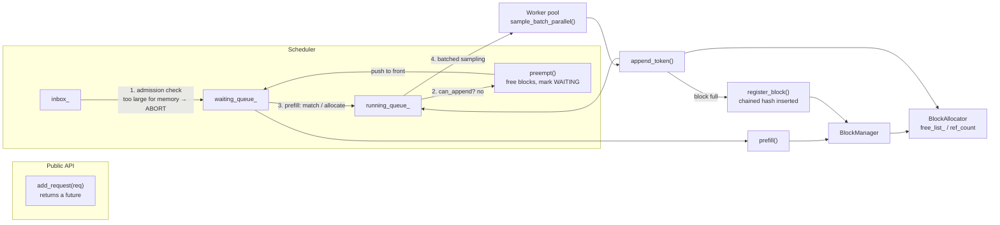
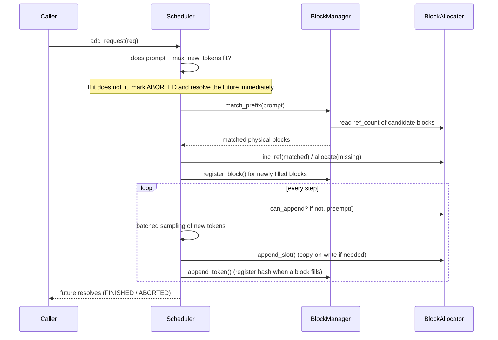

**English** | [简体中文](README.zh-CN.md)

# KV_Cache — Reproducing vLLM's Paged KV Cache and Scheduler in C++17

> A study project: reimplementing the core of vLLM from scratch in modern C++ — **paged KV cache, per-block reference counting with copy-on-write, chained prefix-hash reuse, continuous batching, and preemption**.
> No GPU kernels and no real model inference. The focus is a readable, testable implementation of the memory-management and scheduling layer.


[](https://github.com/laoyeye831/learn-vllm-paged-kvcache/actions/workflows/ci.yml)

> **Note on language:** source comments, the `docs/` guides, and this project's development log are written in **Chinese**. This English README and the Chinese one are kept in sync on facts; the code is the source of truth.

## What this is

vLLM's PagedAttention splits the KV cache into fixed-size physical blocks and keeps a `block_table` mapping logical blocks to physical ones, which eliminates fragmentation and makes prefix sharing cheap. This project rebuilds that **data structure and scheduling policy** in dependency-free C++17, with token ids standing in for real KV tensors.

It is useful for understanding how vLLM manages memory, studying reference-counted resource lifetimes, and practising the design and testing of a multithreaded scheduler.

## Features

| Feature | Description |
|---|---|
| **Paged KV cache** | `BLOCK_SIZE = 16`; `block_table` and `slot_mapping` handle logical-block and slot addressing |
| **Reference-counted allocator** | Free list + `ref_count`, with `allocate` / `inc_ref` / `dec_ref` / `free` |
| **Copy-on-write** | Writing to a shared tail block splits it; an exclusively owned tail block is written in place |
| **Prefix cache reuse** | Chained polynomial hashing; a block is registered as soon as it fills, and lazily invalidated when the block is reallocated |
| **Continuous batching** | A `step()` with four phases: admission → preemption → new-request admission → batched sampling |
| **Preemption with recompute** | When space runs out, the tail of the running queue is preempted, its blocks freed, and the request pushed to the front of the waiting queue |
| **Async engine** | A scheduler thread plus a worker sampling pool; `add_request()` returns `std::future<void>` that fires on completion |
| **Invariant checking** | Every step validates block ref-counts, queue lengths and free-block counts; stress tests cross-check serial vs. parallel runs |

## Architecture



Full lifecycle of a single request:



## Quick start

Requirements: CMake >= 3.20 and a C++17 compiler (MSVC 2019+, GCC 9+, Clang 10+). **No third-party dependencies.**

```bash
cmake -B build -G Ninja -DCMAKE_BUILD_TYPE=Debug
cmake --build build
ctest --test-dir build --output-on-failure
```

- **Windows + MSVC**: run this from *Developer PowerShell for VS* (it provides `cl.exe` and `ninja`), or use the VS Code CMake Tools extension (the Ninja generator is already configured in `.vscode/settings.json`).
- If `ninja` is not installed, drop `-G Ninja` and use the default generator (with a multi-config generator, add `-C Debug` to `ctest`).

### Build options

| Option | Default | Description |
|---|---|---|
| `KV_CACHE_ENABLE_TSAN` | `OFF` | Build with ThreadSanitizer (GCC/Clang only; MSVC fails fast). Concurrency tests are tagged `concurrency` |
| `KV_CACHE_BUILD_EXAMPLES` | `ON` | Build `examples/demo.cpp` |

```bash
# Run the concurrency suite under ThreadSanitizer
cmake -B build-tsan -DCMAKE_BUILD_TYPE=Debug -DKV_CACHE_ENABLE_TSAN=ON
cmake --build build-tsan --parallel
ctest --test-dir build-tsan --output-on-failure
```

> On newer kernels, high-entropy ASLR makes TSan abort with `unexpected memory mapping`. Run `sudo sysctl vm.mmap_rnd_bits=28` first (CI does this).

### Run the demo

```bash
./build/kvcache_demo
```

The demo runs three scenarios: prefix reuse with copy-on-write, cross-batch prefix-cache hits, and preemption with recompute. It prints in Chinese; here is the key result from the cross-batch scenario, translated:

```text
Input : 3 requests, all sharing the same 48-token prompt (3 full blocks)
Pool  : 32 blocks

Peak blocks in use : 6   (3 shared prefix blocks + 3 private decode blocks)
Without prefix reuse : 12
Preemptions          : 0
```

And from the copy-on-write scenario, the reference count of a shared block across the whole flow:

```text
prefill(r1)        block 0 ref_count = 1     # allocated
prefill(r2)        block 0 ref_count = 2     # prefix hit, reused
fork_sequence(r2)  block 0 ref_count = 3     # forked
decode(son)        block 0 ref_count = 3     # read-only, no copy
                   tail block splits        # ref_count was 2 -> copy-on-write
after release(all) blocks free = 16/16
```

## Tests

| Test binary | Coverage | Cases |
|---|---|---|
| `kvcache_phase1_3_test` | Allocator, prefill, decode, copy-on-write, fork, prefix hit/miss/invalidate/rollback | 42 |
| `scheduler_test` | Admission, preemption, resume order, output consistency, oversized-request abort | 9 |
| `scheduler_thread_test` | Background-thread lifecycle, concurrent producers, worker-pool parallelism and shutdown | 10 |
| `random_pressure_test` | Random workloads: small pool (frequent preemption) vs. large pool (none), outputs compared token by token | randomized |
| `thread_stress_test` | Multiple producers + scheduler thread + worker pool, invariants checked every step | randomized |
| `kvcache_demo` | Smoke test: the demo must run to completion, covering scheduler termination and shutdown | 1 |

All of the above pass on **GCC 11 (Linux)** and **MSVC 19.51 (Windows)**, are **clean under ThreadSanitizer**, and the library builds without warnings under `-Wall -Wextra`.

Tests use the bundled `tests/test_util.h` (`CHECK` / `EXPECT_EQ` / `RUN_TEST`). `check_invariants()` verifies on every step that:

- each physical block's `ref_count` equals the number of active requests referencing it
- the number of blocks with `ref_count == 0` equals the free-list length
- a `RUNNING` request's `block_table` length matches its `sequence_length`
- a `WAITING` request (after preemption) has an empty `block_table`

## Repository layout

```
KV_Cache/
├── include/
│   └── kvcache.h          # Data structures and interfaces: PhysicalBlock / Request / BlockAllocator / BlockManager / Scheduler
├── src/
│   ├── allocator.cpp      # Physical block allocation and reference counting
│   ├── manager.cpp        # Chained prefix hashing, cache registration and matching, request release
│   ├── other.cpp          # prefill / append_slot (CoW) / append_token / fork_sequence / fake_sample
│   └── scheduler.cpp      # Four-phase step(), preemption, scheduler thread and worker pool
├── examples/
│   └── demo.cpp           # Executable demo: prefix reuse, CoW, cross-batch cache hits, preemption
├── tests/                 # Unit and stress tests; test_util.h provides assertions and invariant checks
├── docs/
│   ├── ARCHITECTURE.md    # Layers, data structures, four-phase scheduling, locking rules, invariants (Chinese)
│   ├── VLLM_MAPPING.md    # Symbol-by-symbol mapping from this project to vLLM's source (Chinese)
│   └── DEVLOG.md          # Development log: daily goals, dead ends, leftovers (Chinese)
├── .clang-format
├── .github/workflows/ci.yml
└── CMakeLists.txt
```

## Documentation

| Document | Contents |
|---|---|
| [docs/ARCHITECTURE.md](docs/ARCHITECTURE.md) | Module layers, data structures, request lifecycle, four-phase `step()`, reference counting and CoW, concurrency and locking rules, the four invariants **(Chinese)** |
| [docs/VLLM_MAPPING.md](docs/VLLM_MAPPING.md) | Side-by-side comparison with vLLM's `BlockAllocator` / `PrefixCachingBlockAllocator` / `Scheduler`, plus what is deliberately not implemented **(Chinese)** |
| [docs/DEVLOG.md](docs/DEVLOG.md) | Seven-day development log explaining decisions such as "why `break` instead of `continue`" and "why `set_value` must happen outside the lock" **(Chinese)** |

## Code style

- **Comments are in Chinese.** Interfaces live in `include/kvcache.h`; implementations are split by responsibility under `src/`.
- Formatting uses the repository's [.clang-format](.clang-format), tuned to the existing style (4-space indent, Allman braces, no space before `(` in control statements, includes not reordered):

```bash
clang-format -i include/kvcache.h src/*.cpp tests/*.cpp tests/*.h examples/*.cpp
```

- CI enforces it with `clang-format --dry-run --Werror`, pinned to version `23.1.5`.

## Known limitations

This is a study project; the following are **deliberate simplifications**, not bugs waiting to be fixed:

- **No real KV data.** The copy-on-write branch of `append_slot()` only prints `copy valid tokens to new block`; no tensors are moved. Blocks carry metadata only.
- **No LRU eviction.** `PhysicalBlock::last_accessed` is unused and `free_list_` is FIFO. Stale hash entries are caught by the `has_hash` / `hash` check instead of being evicted.
- **No CPU swap.** Preemption uses release-and-recompute (which requires `all_tokens.size() == sequence_length`, i.e. a replayable prompt). The `SWAPPED` state exists but is unused.
- **Static worker sharding.** Batches are split as `n / num_workers`, so a long task leaves other workers idle. Dynamic dispatch (a shared atomic cursor) is not implemented.
- **Placeholder sampler.** `fake_sample()` is a deterministic hash so results can be compared token by token; no model is involved.
- **Hard-coded constants.** `BLOCK_SIZE = 16` and `WATER_MARK = 4` are compile-time constants; there is no configuration file.
- **No hash-collision fallback.** The 64-bit polynomial hash makes collisions vanishingly unlikely, but they are not otherwise guarded.

## Roadmap

- [x] `examples/demo.cpp`: demonstrate prefix reuse, copy-on-write and preemption
- [x] `docs/ARCHITECTURE.md` / `docs/VLLM_MAPPING.md` / `docs/DEVLOG.md`
- [x] GitHub Actions CI (Linux/GCC + Windows/MSVC + ThreadSanitizer + clang-format)
- [x] `include/` + `src/` layout with a unified clang-format style
- [ ] Dynamic worker dispatch (shared atomic cursor) to remove tail idle time
- [ ] LRU eviction of free blocks, replacing the FIFO free list
- [ ] Make `BLOCK_SIZE` / `WATER_MARK` configurable at runtime
- [ ] Add GPU ↔ CPU swap semantics (currently `ReqState::SWAPPED` is unused)
- [ ] Report cache hit rate and block utilization as comparable metrics

## Disclaimer

This is a personal study project, unaffiliated with the [vLLM](https://github.com/vllm-project/vllm) project. It contains no vLLM source code.

## License

[MIT](LICENSE)
