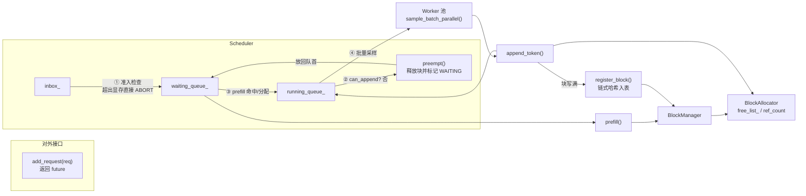
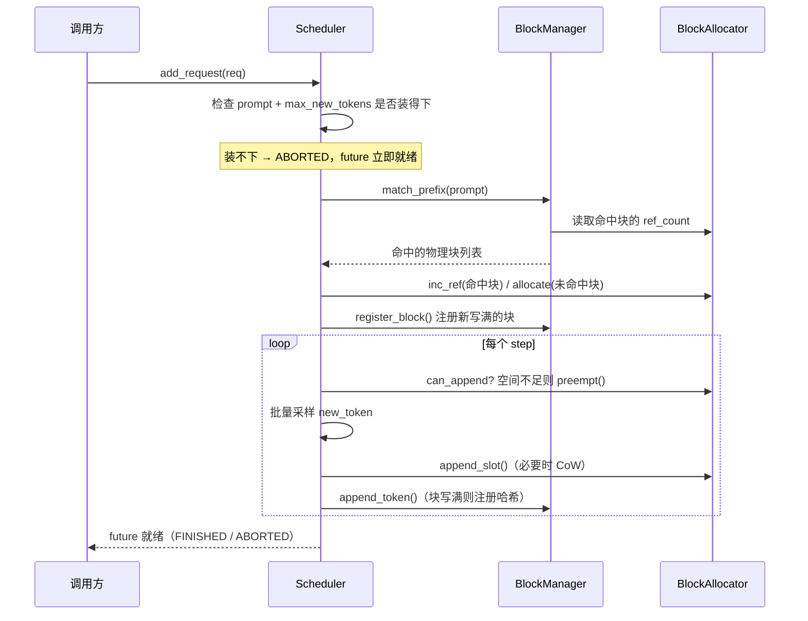

[English](README.md) | **简体中文**

# KV_Cache — 用 C++17 复现 vLLM 的分页 KV Cache 与调度器

> 学习项目：从零用 C++17 实现 vLLM 的核心机制 —— **分页 KV Cache、块级引用计数与写时复制、链式前缀哈希复用、连续批处理与抢占调度**。
> 不包含 GPU kernel 与真实模型推理，专注内存管理与调度逻辑的可读实现与可测试性。

英文版为仓库默认页 → [README.md](README.md)。两版在事实层面保持同步，如有出入以代码为准。


[](https://github.com/laoyeye831/learn-vllm-paged-kvcache/actions/workflows/ci.yml)

## 这是什么

`vLLM` 的 PagedAttention 把 KV Cache 切成固定大小的物理块，用 `block_table` 做逻辑块到物理块的映射，从而解决显存碎片与前缀复用问题。本项目把这套机制的**数据结构与调度策略**用纯 C++ 重新实现了一遍，KV 内容用整数模拟，不依赖任何第三方库。

适合用来：理解 vLLM 的内存管理思路、学习 `shared_ptr` + 引用计数的资源生命周期管理、练习多线程调度器的设计与测试。

## 核心特性

| 特性 | 说明 |
|---|---|
| **分页 KV Cache** | `BLOCK_SIZE = 16`，`block_table` / `slot_mapping` 完成逻辑块与槽位寻址 |
| **引用计数分配器** | 空闲链表 + `ref_count`，支持 `allocate` / `inc_ref` / `dec_ref` / `free` |
| **写时复制 (CoW)** | 共享尾块被写入时自动分裂，非共享尾块原地写入 |
| **前缀缓存复用** | 链式多项式哈希，块写满即注册；块被重分配后校验失效并剔除 |
| **连续批处理** | `step()` 四阶段：准入 → 抢占 → 新请求加入 → 批量采样 |
| **抢占与重算** | 空间不足时抢占运行队列尾部，释放块后放回等待队列队首优先恢复 |
| **异步引擎** | 调度线程 + Worker 采样池，`add_request()` 返回 `std::future<void>` 通知完成 |
| **不变量检查** | 每一步校验块引用计数、队列长度、空闲块数等，压力测试自动串行/并行对拍 |

## 架构



一次请求的完整生命周期：



## 快速开始

要求：CMake ≥ 3.20、C++17 编译器（MSVC 2019+ / GCC 9+ / Clang 10+），**无第三方依赖**。

```bash
cmake -B build -G Ninja -DCMAKE_BUILD_TYPE=Debug
cmake --build build
ctest --test-dir build --output-on-failure
```

- **Windows + MSVC**：请在 *Developer PowerShell for VS* 中执行（该环境自带 `cl.exe` 与 `ninja`），或直接使用 VS Code 的 CMake Tools 插件（已在 `.vscode/settings.json` 中指定 Ninja 生成器）。
- 如果本机没有 `ninja`，删掉 `-G Ninja` 使用默认生成器即可（多配置生成器下 ctest 需加 `-C Debug`）。

### 构建选项

| 选项 | 默认 | 说明 |
|---|---|---|
| `KV_CACHE_ENABLE_TSAN` | `OFF` | 启用 ThreadSanitizer（仅 GCC/Clang，MSVC 会直接报错）。开启后并发测试带 `concurrency` 标签 |
| `KV_CACHE_BUILD_EXAMPLES` | `ON` | 是否构建 `examples/demo.cpp` |

```bash
# 用 ThreadSanitizer 跑并发测试
cmake -B build-tsan -DCMAKE_BUILD_TYPE=Debug -DKV_CACHE_ENABLE_TSAN=ON
cmake --build build-tsan --parallel
ctest --test-dir build-tsan --output-on-failure
```

> 新内核的高熵 ASLR 会让 TSan 报 `unexpected memory mapping`，先执行 `sudo sysctl vm.mmap_rnd_bits=28`（CI 里已这样做）。

### 运行 demo


构建完成后先跑一次 demo，能直观看到前缀复用、写时复制与抢占的效果：

```bash
./build/kvcache_demo            # 约 2 秒跑完、无停顿（ctest 跑的就是这个）
./build/kvcache_demo --paced    # 每步停顿 + 配色，录制上面的 GIF 用
```

`--paced` 只影响观感：每步后插入 `sleep`（默认 900ms，`--beat-ms=N` 可调）并给命中、引用计数变化、CoW 分裂上色；不带参数时输出同样的文本但没有停顿和转义序列，所以 CI 里的冒烟测试依然很快。

重新录制 GIF：

```bash
# 一次性安装：winget install charmbracelet.vhs tsl0922.ttyd Gyan.FFmpeg.Essentials
vhs docs/demo.tape              # 生成 docs/demo.gif
```

[docs/demo.tape](docs/demo.tape) 负责画布、主题和截帧节奏，`--paced` 负责每一步停留多久；画布按「全程不滚动」推算（13pt 下 76 行 × 88 列），改动 `Sleep` 时记得同步 `--beat-ms`。

输出节选（A 段：同 prompt 的第二个请求直接复用物理块，fork 后尾块写入触发 CoW）：

```text
[2] r2 prefill same prompt: ok=1, hit blocks=2, free=12
    -> first 2 blocks reuse r1's blocks (ref 1 -> 2), only 1 block is new
r2                 block_table=[0(ref=2) 1(ref=2) 3(ref=1)]

[3] fork_sequence(r2) -> ref_count +1 for every block, free still 12
son                block_table=[0(ref=3) 1(ref=3) 3(ref=2)]

[4] son decodes one token (tail block ref_count>1 -> CoW)
    BLK #3 (ref=2) splits -> BLK #4 (ref=1); #3 stays shared by r2 (ref=1)
    tail 3 -> 4, slot=72, free=11
```

逐个运行测试可看到每个用例的通过情况：

```bash
./build/kvcache_phase1_3_test
./build/scheduler_test
./build/scheduler_thread_test
./build/random_pressure_test
./build/thread_stress_test
```

## 测试

| 测试可执行文件 | 覆盖内容 | 用例数 |
|---|---|---|
| `kvcache_phase1_3_test` | 分配器、prefill、decode、CoW、fork、前缀命中/失效/回滚 | 42 |
| `scheduler_test` | 准入、抢占、恢复顺序、输出一致性、超长请求中止 | 9 |
| `scheduler_thread_test` | 后台线程生命周期、并发生产者、Worker 池并行与停机 | 10 |
| `random_pressure_test` | 随机负载下小池（频繁抢占）与大池（无抢占）结果对拍 | 随机 |
| `thread_stress_test` | 多生产者 + 调度线程 + Worker 池并发，逐步校验不变量 | 随机 |
| `kvcache_demo` | 冒烟测试：demo 必须跑完，覆盖调度器终止性与停机路径 | 1 |

全部用例在 **GCC 11（Linux）** 与 **MSVC 19.51（Windows）** 下通过，且在 **ThreadSanitizer** 下零告警；库代码在 `-Wall -Wextra` 下无警告。

所有用例使用自带的 `tests/test_util.h`（`CHECK` / `EXPECT_EQ` / `RUN_TEST`），`check_invariants()` 会在每一步验证：

- 每个物理块的 `ref_count` 等于所有活跃请求引用它的次数
- `ref_count == 0` 的块数量等于空闲链表长度
- `RUNNING` 请求的 `block_table` 长度与 `sequence_length` 匹配
- `WAITING` 请求（被抢占后）的 `block_table` 必须为空

## 目录结构

```
KV_Cache/
├── include/
│   └── kvcache.h          # 数据结构与接口：PhysicalBlock / Request / BlockAllocator / BlockManager / Scheduler
├── src/
│   ├── allocator.cpp      # 物理块分配、引用计数
│   ├── manager.cpp        # 链式前缀哈希、缓存注册与匹配、请求释放
│   ├── other.cpp          # prefill / append_slot(CoW) / append_token / fork_sequence / fake_sample
│   └── scheduler.cpp      # 四阶段 step()、抢占、调度线程与 Worker 池
├── examples/
│   └── demo.cpp           # 可执行演示：前缀复用、CoW、跨批次缓存命中、抢占
├── tests/                 # 单元测试与压力测试，test_util.h 提供断言与不变量检查
├── docs/
│   ├── ARCHITECTURE.md    # 分层、数据结构、四阶段调度、锁纪律、不变量
│   ├── VLLM_MAPPING.md    # 本项目符号 ↔ vLLM 源码位置的逐条对照
│   ├── DEVLOG.md          # 开发日志：每天的目标、踩坑与遗留项
│   ├── demo.gif           # 录制好的演示，嵌在上面的「运行 demo」里
│   └── demo.tape          # 生成 demo.gif 的 VHS 脚本
├── .clang-format          # 与现有代码风格对齐的格式化配置
├── .github/workflows/ci.yml
└── CMakeLists.txt
```

## 文档

| 文档 | 内容 |
|---|---|
| [docs/ARCHITECTURE.md](docs/ARCHITECTURE.md) | 模块分层、数据结构、一次请求的生命周期、四阶段 `step()`、引用计数与 CoW、并发与锁纪律、四条不变量 |
| [docs/VLLM_MAPPING.md](docs/VLLM_MAPPING.md) | 逐条对照 vLLM 的 `BlockAllocator` / `PrefixCachingBlockAllocator` / `Scheduler`，并列出刻意未实现的部分 |
| [docs/DEVLOG.md](docs/DEVLOG.md) | 7 天开发日志，记录「为什么是 `break` 而不是 `continue`」「为什么 promise 要在锁外 `set_value`」这类决策过程 |

## 代码风格

- 代码注释为**中文**；数据结构与接口集中在 `include/kvcache.h`，实现按职责拆到 `src/`。
- 使用仓库根目录的 [.clang-format](.clang-format)（配置按现有代码风格定制：4 空格缩进、Allman 大括号、`if(` 前不加空格、不重排 include）：

```bash
clang-format -i include/kvcache.h src/*.cpp tests/*.cpp tests/*.h examples/*.cpp
```

- CI 会用 `clang-format --dry-run --Werror` 校验格式，版本固定为 `23.1.5`。

## 已知限制

这是学习项目，以下部分是**刻意简化**的，不是待修复的 bug：

- **没有真实 KV 数据**：`append_slot()` 的 CoW 分支仅通过 `BlockManager::num_cow_copies()` / `num_cow_tokens()` 计数，不搬运 tensor；每个块只记录元信息。
- **仅保留 Recompute 抢占**：已移除 `SWAPPED`（与 vLLM v1 一致，不做 CPU 换出）；抢占释放块后由 `match_prefix()` 复用存活满块并重算剩余部分。
- **采样器是占位实现**：`fake_sample()` 是一个确定性哈希函数，用于让结果可对拍，不涉及任何模型。
- **哈希无碰撞兜底**：链式多项式哈希 64 位，理论碰撞概率极低但未做额外校验。

## Benchmark

### 1. 前缀缓存与淘汰策略（`./build/kvcache_bench --sweep`）

默认 `seed=42`，`block_size=16`，支持 `--workload sysprompt|chat|zipf|mixed`、`--blocks N`、`--policy fifo|lru`、`--prefix on|off`、`--csv`：

| workload | blocks | policy / prefix | hit% | evictions | revivals | preempt | steps | tok/step |
|---|---:|---|---:|---:|---:|---:|---:|---:|
| `sysprompt` | 24 | `prefix off` | 0.0% | 0 | 0 | 1 | 510 | 2.24 |
| `sysprompt` | 24 | `fifo` + prefix | 71.7% | 187 | 30 | 0 | 307 | 3.72 |
| `sysprompt` | 24 | `lru` + prefix | **73.0%** | **178** | **36** | 0 | 307 | 3.72 |
| `chat` | 64 | `prefix off` | 0.0% | 0 | 0 | 0 | 174 | 3.80 |
| `chat` | 64 | `fifo` + prefix | 15.0% | 344 | 64 | 0 | 174 | 3.80 |
| `chat` | 64 | `lru` + prefix | **17.6%** | **332** | **75** | 0 | 174 | 3.80 |
| `zipf` | 32 | `prefix off` | 0.0% | 0 | 0 | 1 | 252 | 3.70 |
| `zipf` | 32 | `fifo` + prefix | 51.1% | 207 | 28 | 0 | 250 | 3.73 |
| `zipf` | 32 | `lru` + prefix | **53.3%** | **195** | **36** | 0 | 250 | 3.73 |
| `zipf` | 48 | `fifo` + prefix | 61.1% | 158 | 64 | 0 | 250 | 3.73 |
| `zipf` | 48 | `lru` + prefix | **64.4%** | **139** | **76** | 0 | 250 | 3.73 |

### 2. Chunked Prefill + Token Budget（`./build/kvcache_bench --chunked-sweep`）

`mixed` 长短混合负载（80% 短 prompt 长 decode + 20% 384–512 token 长 prompt，`blocks=256`，`max_num_seqs=16`，step-cost 模拟时钟 `5ms + 0.25ms/token`）：

| chunked | token budget | avg TTFT (ms) | p99 TTFT (ms) | ITL p50 (ms) | ITL p99 (ms) | Throughput (tok/s) |
|---|---:|---:|---:|---:|---:|---:|
| `off` | unlimited | 76.7 | 148.5 | 8.0 | 139.5 | 639.6 |
| `on` | 128 | 78.4 | 180.8 | 8.2 | **37.0 (-73.5%)** | 635.3 |
| `on` | 64 | 122.1 | 250.5 | 21.0 | **21.0 (-84.9%)** | 630.0 |
| `on` | 32 | 719.9 | 1383.8 | 13.0 | **13.0 (-90.7%)** | 542.8 |

## Roadmap

- [x] `examples/demo.cpp`：演示前缀复用、写时复制与抢占
- [x] `docs/ARCHITECTURE.md` / `docs/VLLM_MAPPING.md` / `docs/DEVLOG.md`
- [x] GitHub Actions CI（Linux/GCC + Windows/MSVC + ThreadSanitizer + clang-format）
- [x] 源码整理为 `include/` + `src/` 布局，统一 clang-format 风格
- [x] Worker 池改为动态分发（共享原子游标），消除长尾空等
- [x] 把 `block_size` / `watermark`（含比例模式）/ `enable_prefix_caching` 改为运行期可配置
- [x] 前缀哈希零拷贝 + `register_block` $O(1)$ 增量计算，补齐队列并发观察锁保护
- [x] 引入 $O(1)$ 侵入式双向链表与三态 LRU 淘汰（CLEAN 优先 + CACHED LRU + 主动清理哈希表）
- [x] 指标统计与 `bench/kvcache_bench.cpp` 对照基准（FIFO vs LRU vs Prefix Off）
- [x] Schedule / Execute 解耦（`SchedulerOutput`）、移除 `SWAPPED`、Chunked Prefill + Token Budget 与 TTFT/ITL 对比基准

## 声明

本项目为个人学习复现，与 [vLLM](https://github.com/vllm-project/vllm) 官方项目无关，不包含 vLLM 的任何源代码。

## License

[MIT](LICENSE)
