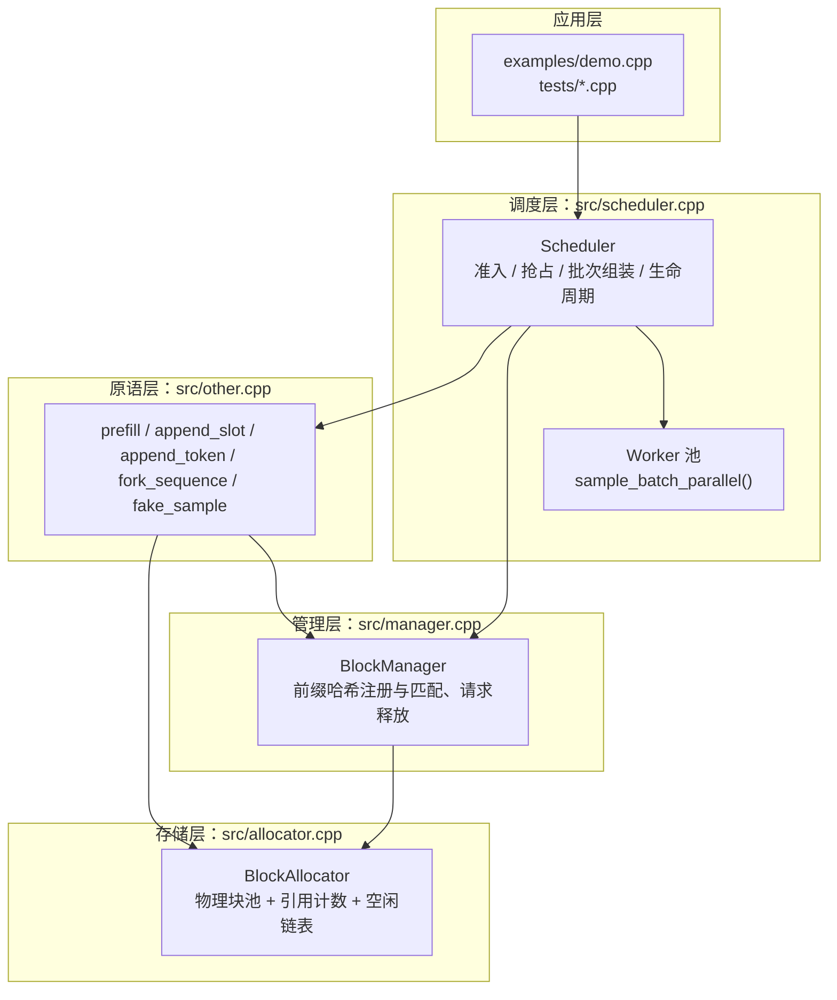
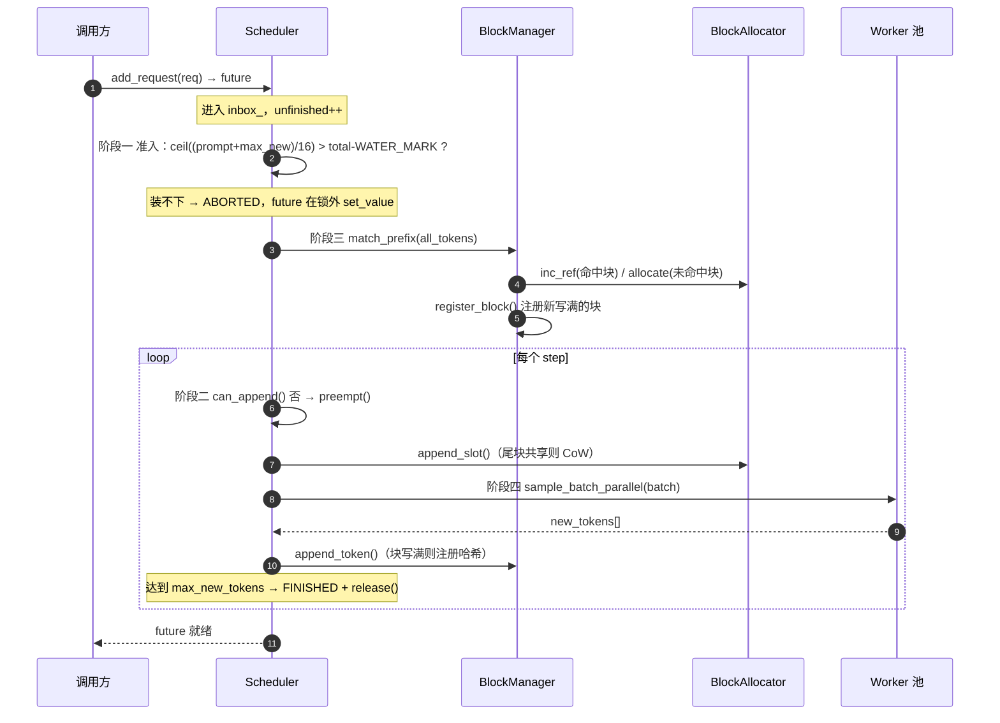
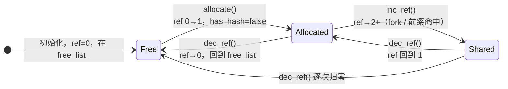
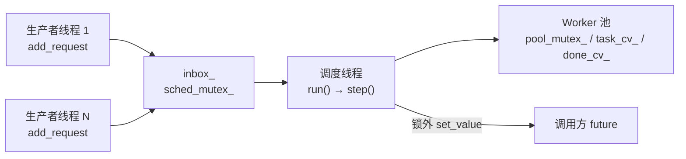
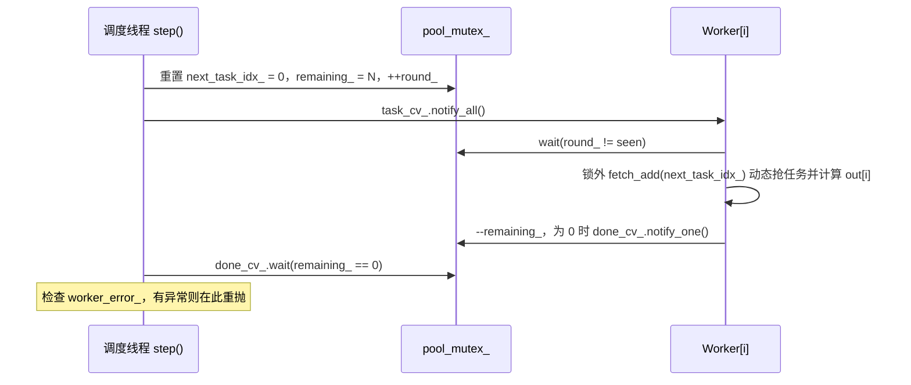
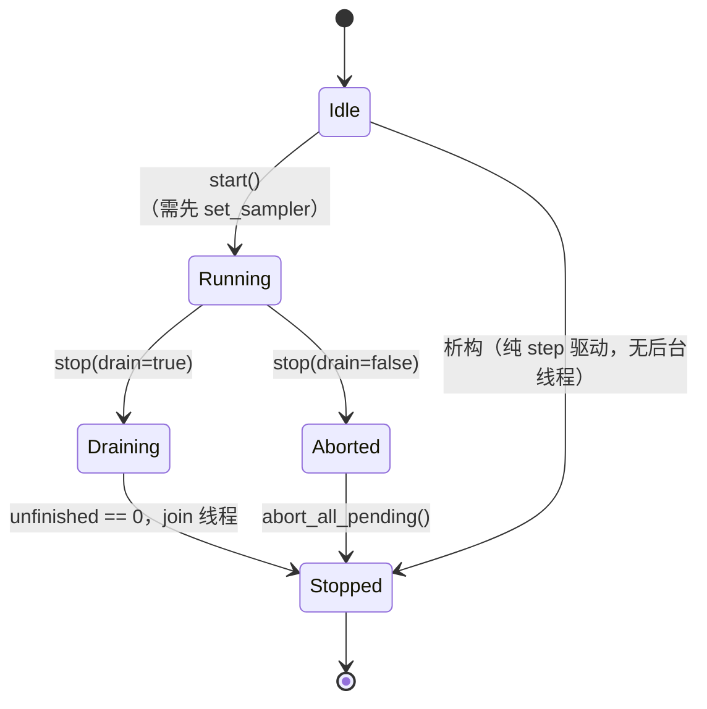

# 架构说明

本文档描述代码的组织方式、各模块的职责边界、一次请求的完整数据流，以及调度器的并发与锁纪律。
如果你只想知道「每块代码对应 vLLM 的哪一部分」，直接看 [VLLM_MAPPING.md](VLLM_MAPPING.md)。

## 1. 分层



依赖方向严格单向：**上层只通过裸指针 / 引用持有下层**（`BlockManager` 持有 `BlockAllocator*`，`Scheduler` 持有 `BlockManager&`），没有反向回调，也没有 `shared_ptr` 所有权纠缠。所有析构由测试 / demo 的栈作用域负责。

| 文件 | 职责 | 对外暴露 |
|---|---|---|
| `include/kvcache.h` | 全部数据结构与接口声明 | `PhysicalBlock` / `Request` / `ReqState` / `BlockAllocator` / `BlockManager` / `Scheduler` |
| `src/allocator.cpp` | 物理块的分配、释放、引用计数 | `BlockAllocator` 成员函数 |
| `src/manager.cpp` | 链式前缀哈希、缓存表、请求释放 | `BlockManager` 成员函数 |
| `src/other.cpp` | 请求生命周期的原语操作 | `prefill` / `append_slot` / `append_token` / `fork_sequence` / `fake_sample` |
| `src/scheduler.cpp` | 调度循环、抢占、后台线程与 Worker 池 | `Scheduler` 成员函数 |

## 2. 核心数据结构

### 2.1 PhysicalBlock —— 物理块

```cpp
struct PhysicalBlock {
    int block_id;
    int ref_count{0};          // 被多少条序列引用
    uint64_t last_accessed{0}; // 预留给 LRU，当前未使用
    uint64_t hash{0};          // 该块在前缀链上的哈希
    bool has_hash{false};      // 是否仍登记在前缀缓存中
};
```

`has_hash` 与 `hash` 组成**双字段校验**：块被 `allocate()` 复用时会清掉 `has_hash`，`match_prefix()` 命中后要再确认一次，避免把「哈希表里残留的条目」当成有效缓存。

### 2.2 Request —— 一条推理请求

| 字段 | 含义 |
|---|---|
| `block_table` | 逻辑块号 → 物理块号 |
| `slot_mapping` | 本步要写入的物理槽号（**每步重置，只含当前 token**，不是历史累积） |
| `all_tokens` | prompt + 已生成的 token，用于重算与哈希 |
| `sequence_length` | 当前序列长度（被抢占后由 `release()` 清零，再 `prefill()` 重建） |
| `num_cached_blocks` | `block_table` 开头已命中 / 已注册进缓存的块数 |
| `s` | `WAITING` / `RUNNING` / `SWAPPED` / `FINISHED` / `ABORTED` |
| `max_new_tokens` / `num_generated_tokens` | 生成长度预算与实际进度（调度与终止条件） |

> `slot_mapping` 的语义在 Day 1 曾走过弯路（见 [DEVLOG](DEVLOG.md)）：它表示「**这一步**要写哪几个物理槽」，因此 `append_slot()` 每次都先 `clear()` 再压入唯一的槽号。

### 2.3 前缀哈希链

```
block0_hash = H(SEED,           tokens[0:16])
block1_hash = H(block0_hash,    tokens[16:32])
block2_hash = H(block1_hash,    tokens[32:48])
```

`compute_hash` 是**多项式滚动哈希**（`h = h * 911382629 + token`），把上一块的哈希作为下一块的种子，于是「第 i 块的哈希」天然蕴含了整个前缀。这样：

- 前缀相同 → 逐块命中，直到第一个不同的块为止；
- 从中间某块开始分叉 → 后续哈希全部不同，不会误命中；
- 注册时只需要从 0 号块重新推一遍链，不需要保存中间状态。

## 3. 一次请求的完整流程



### `step()` 的四阶段

| 阶段 | 动作 | 关键点 |
|---|---|---|
| ① 准入 | `inbox_` → `waiting_queue_` | 用 `ceil((N+max_new)/BLOCK_SIZE) > num_blocks - WATER_MARK` 直接判死，避免一个永远跑不完的请求把队列堵死；被拒的请求标 `ABORTED` 并立刻兑现 future |
| ② 抢占 | 遍历 `running_queue_` | `while(!can_append(req)) preempt()`；`preempt()` 抢占**队尾**（最晚到达的请求），释放块后 `push_front` 到等待队列，下次优先恢复 |
| ③ 准入新请求 | `waiting_queue_` → `running_queue_` | **仅在阶段二没有发生抢占时执行**；空间不够就 `break` 而非 `continue` |
| ④ 批量执行 | 采样 + 追加 token | 采样不持任何锁；`append_token` 在锁内完成；`FINISHED` 的请求 `release()` 块并兑现 future |

两个「反直觉」的设计值得单独说明：

**为什么阶段三是 `break` 而不是 `continue`？**
如果放过队首装不下的大请求去塞后面能装下的小请求，那个大请求可能永远等不到足够的连续空间（后来的小请求会不断填充空隙），形成饥饿。`break` 保证等待队列严格按到达顺序准入。

**为什么阶段三要「没抢占才进新请求」？**
发生抢占说明显存已经紧张，此时再放进新请求只会引发连锁抢占，把刚被抢占的请求又挤出去。等下一轮空间释放后再准入，抖动更小。

## 4. 引用计数与写时复制



**尾块写入时的三种情况**（`append_slot()`）：

| 条件 | 行为 | 代价 |
|---|---|---|
| `seq_len % 16 == 0` | 新块边界，`allocate()` 一个新块追加到 `block_table` | 1 块 |
| 尾块 `ref_count == 1` | 独占，原地写入 | 0 |
| 尾块 `ref_count > 1` | **CoW**：分配新块 → 替换 `block_table` 尾项 → 拷贝有效 token → 原块 `dec_ref` | 1 块 + 一次拷贝 |

> `ref_count == 0` 但 `has_hash == true` 的块可以被 `inc_ref()` 直接「复活」：`inc_ref` 会先把它从 `free_list_` 里摘掉（`list::remove`，O(n)），从而让已释放但内容仍有效的块被前缀缓存命中后重新使用。

## 5. 并发模型



`Scheduler::start()` 一次性拉起 **1 个调度线程 + N 个 Worker**；`stop(drain)` 先停调度线程再停 Worker 池；析构函数调用 `stop(true)`，所以栈对象可以直接用。

### 锁职责表

| 互斥量 | 保护对象 | 备注 |
|---|---|---|
| `sched_mutex_` | `inbox_`、`next_arrival_id_`、`stop_flag_`、`sched_cv_` | `add_request` 与阶段一竞争 |
| `pending_mutex_` | `pending_`（`arrival_id → promise`） | 与 `sched_mutex_` 成对获取，顺序固定 |
| `waiting_mutex_` / `running_mutex_` | 两个队列的**观察**（`waiting()` / `running()`） | `mutable`，供 const 只读访问器加锁 |
| `step_mutex_` | 整个 `step()` | 保证同一时刻只有一个推进者（调度线程 或 测试的 `step()`） |
| `pool_mutex_` | 池状态：`round_`、`remaining_`、`cur_*`、`worker_error_` | 派活与收工都靠它 + 两个条件变量 |
| `task_cv_` / `done_cv_` | 派活 / 收工的等待点 | `round_` 翻牌机制取代「队列 + 哨兵」 |
| `alloc_mutex_` | `free_list_`、`ref_count` | 粒度最细，只保护分配器内部 |
| `step_mutex_` 之外的锁外区 | 采样计算 | 计算不持锁，否则并行退化成串行 |

### 三条铁律

1. **多把锁的获取顺序固定**：`sched_mutex_` → `pending_mutex_` → `running_mutex_` → `waiting_mutex_` → `alloc_mutex_`，任何地方都不反向（包括 `step()` 阶段二/三与 `abort_all_pending()`）。
2. **promise 只在锁外 `set_value()`**：被唤醒的调用方可能立刻回头调 `add_request()`，若在锁内兑现就会自己堵自己（Day 6 的踩坑记录）。
3. **运行中不可替换回调**：`set_sampler()` / `set_step_hook()` 用 `assert(!started_)` 拦住，因为 Worker 会并发只读这两个 `std::function`。

### Worker 池的派活协议



- **动态分发（原子游标）**：每个 Worker 在锁外通过 `next_task_idx_.fetch_add(1)` 抢下一个任务下标，遇到长尾慢请求时其余 Worker 可继续消化剩余任务，不再空等。
- **单请求短路 & 空批次不翻牌**：`batch.empty()` 直接返回；`batch.size() == 1` 直接在调度线程串行采样，省去无意义的线程唤醒开销。
- **多余 Worker 也会减 `remaining_`**：请求数少于 Worker 数时，没抢到任务的 Worker 立即退出循环并「收工」，这是 `test_pool_more_workers_than_requests` 覆盖的场景。
- **异常跨线程传播**：Worker 里的异常存进 `worker_error_`，由调度线程在主线程栈上 `rethrow`，不会静默丢失。

## 6. 不变量

`tests/test_util.h` 的 `check_invariants()` 在每个 step 之后（通过 `set_step_hook`）验证以下四条，任一不满足直接 `abort`：

1. 每个物理块的 `ref_count` == 所有活跃请求（`RUNNING ∪ WAITING`）在 `block_table` 中引用它的次数；
2. `ref_count == 0` 的块数 == `free_list_.size()`；
3. `RUNNING` 请求满足 `block_table.size() == ceil(sequence_length / BLOCK_SIZE)`；
4. `WAITING` 请求（被抢占后已 `release`）的 `block_table` 必须为空。

这四条同时钉住了「泄漏」（块没还回去）、「重复释放」（ref 掉到负数）、「表长不一致」（append 逻辑错位）三类最容易出现的 bug。随机压力测试会在此基础上再做一层**对拍**：同一批随机负载分别在小池（频繁抢占）和大池（无抢占）下跑，要求输出 token 逐个相同。

## 7. 生命周期与停机



- `stop()` 内部先 `join` 调度线程（它可能正卡在 `done_cv_` 上等 Worker），再 `stop_pool()`，最后统一 `abort_all_pending()` 兜底——即使从未启动过线程，`pending_` 也会被排空，`future` 一定会就绪。
- `add_request()` 在 `stop_flag_` 已置位时直接返回一个**已完成**的 future，并把请求标为 `ABORTED`，调用方不会永久阻塞。

## 8. 已知简化

| 简化 | 影响 |
|---|---|
| KV 内容是整数模拟，CoW 仅计数不搬运 | 无法测量真实拷贝开销 |
| 空闲链表是 FIFO，`last_accessed` 未使用 | 没有 LRU 淘汰，块回收后靠 `has_hash` 校验失效 |
| 抢占只做「释放 + 重算」，无 `SWAPPED` | `ReqState::SWAPPED` 目前是死枚举 |

完整清单见 README 的「已知限制」一节。
